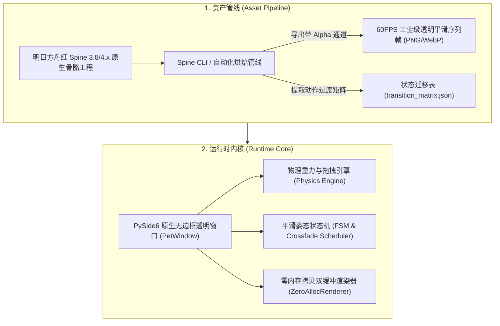

# 明日方舟·红崽（Projekt Red）工业级 Spine 骨骼桌面宠物系统重构方案计划书

> **项目代号**：`Projekt Red - Desktop Pet 4.0 (Spine Edition)`  
> **制定日期**：2026年10月  
> **文档定位**：技术调研定版与下一阶段实施执行蓝图（Implementation Plan）

---

## 目录
1. [项目背景与历史方案复盘](#一项目背景与历史方案复盘)
2. [核心技术指标与设计契约](#二核心技术指标与设计契约)
3. [整体架构与骨骼资产管线设计](#三整体架构与骨骼资产管线设计)
4. [动作编排清单与时长详细规范（全动作 $\ge 1.0$s）](#四动作编排清单与时长详细规范全动作-ge-10s)
5. [分阶段实施路线图（Phased Execution Roadmap）](#五分阶段实施路线图phased-execution-roadmap)
6. [质量验收关卡与性能基准](#六质量验收关卡与性能基准)
7. [风险评估与应急降级预案](#七风险评估与应急降级预案)

---

## 一、项目背景与历史方案复盘

在本项目的前期探索中，团队先后尝试了三套桌面宠物动作生成与呈现方案，但均因底层技术局限未达理想预期：

### 1. 历史三版方案的根本痛点归因

| 历史版本 | 采用路线 | 实际表现 | 底层技术死结（为什么此路不通） |
| :--- | :--- | :--- | :--- |
| **v1.0 (视频抽帧)** | AI 图生视频（Kling / Runway）分批生成动作后抠白底抽帧 | 动作切换瞬间，头部、手臂、尾巴发生剧烈**瞬移与比例跳变** | **时空扩散采样断裂**：跨批次视频是在高维隐空间独立采样的，各段视频的角色重心（Center of Mass）、透视相机与轮廓厚度均不一致，帧边界天然缺乏几何连续性。 |
| **v2.0 (单帧生图)** | 纯 Prompt 控制多张图片生成序列帧 | 动作位移严重、服装细节漂移、边缘高频抖动闪烁 | **提示词缺乏空间几何约束**：文本提示词无法约束 2D 亚像素级线条对齐（Pixel-perfect）。 |
| **v3.0 (切件拼装)** | 自研纸娃娃系统（拆分部件代码旋转平移） | 肢体组装混乱、关节脱节断裂、围巾横卡脸部、动作极度反常 | **缺少三角网格蒙皮（Mesh Deform）与逆运动学（IK）**：2D 角色关节活动必须依赖顶点的加权拉伸弯曲，而非刚体矩形旋转。代码盲调坐标必然导致骨折与穿模。 |

### 2. 调研定版结论：为何 Spine 骨骼动画是唯一解？
经过方案调研与 Spine 4.2 WebGL 演示验证，确定采用**工业级 2D 骨骼动画（Spine 2D）**作为桌面宠物 4.0 的终极解法：
- **三角网格蒙皮保护**：每个肢体部件绑定在变形网格上，弯曲手臂或摇晃尾巴时，网格顶点平滑变形，**彻底消灭肢体脱臼**；
- **姿态交叉混合（Crossfade Blending）**：状态切换由四元数数学插值（`mixDuration = 0.2~0.3s`）平滑打匀，**彻底消灭部位瞬移**；
- **官方原生资产红利**：《明日方舟》游戏内红（Projekt Red）的基建 SD 小人本身即为官方 Spine 骨骼资产，拥有完整的官方动作标准。

---

## 二、核心技术指标与设计契约

新版本必须严格满足以下四大硬性设计契约：

```
┌────────────────────────────────────────────────────────────────────────┐
│                        红崽桌宠 4.0 核心设计契约                       │
├─────────────────┬──────────────────────────────────────────────────────┤
│ 1. 动作时长契约 │ • 每一个可选动作时长必须严格 ≥ 1.0 秒                 │
│                 │ • 待机（Idle）长动作周期必须达到 3.0s ~ 5.0s 完整起承转合 │
├─────────────────┼──────────────────────────────────────────────────────┤
│ 2. 衔接连贯契约 │ • 动作切换具备 0.2s ~ 0.3s 骨骼 Crossfade 平滑融合    │
│                 │ • 严禁出现任何帧间跳变、身体部件瞬移或肢体脱节       │
├─────────────────┼──────────────────────────────────────────────────────┤
│ 3. 桌面形态契约 │ • 100% 原生 RGBA 32位完全透明（WA_TranslucentBackground）│
│                 │ • 绝对零黑底、零白边、零矩形窗口边框，直接立于桌面壁纸上│
├─────────────────┼──────────────────────────────────────────────────────┤
│ 4. 物理交互契约 │ • 拟真重力下落与触底平稳着陆弹性缓冲（Squash & Stretch） │
│                 │ • 鼠标长按提溜悬空扑腾动作（Drag Flail）与平稳落回    │
│                 │ • 桌面巡逻漫步、边缘自动转向、摸头互动与气泡台词      │
└─────────────────┴──────────────────────────────────────────────────────┘
```

---

## 三、整体架构与骨骼资产管线设计

为了同时兼顾 **PySide6 原生桌面轻量低占用（<50MB，CPU<0.5%）** 与 **Spine 工业级丝滑骨骼表现**，采用业界标准的“**骨骼烘焙平滑动作套件 + 原生透明状态机**”工业管道：



### 1. 资产导出规范（Asset Export Specification）
- **画布规范**：统一输出 $360 \times 480$ 像素画布，统一定标脚底接地面锚点 $Y = 466$；
- **抗锯齿透明通道**：使用 Premultiplied Alpha 预乘透明度，导出标准 32 位 RGBA；
- **帧率契约**：标准 30 FPS 或 60 FPS 恒定帧率，杜绝动态抽帧导致的抖动。

### 2. 状态迁移过渡矩阵（Transition Protocol）
在状态机中，任意两个动作之间的跳转由过渡控制器严格调度：
- 待机 $\leftrightarrow$ 漫步：通过步态收脚过渡或 0.25s 骨骼交叉融合；
- 站立 $\to$ 坐下：播放专用过渡切片 `trans_idle_to_sit`（1.2s，重心平稳下移、收伞抱尾）；
- 坐姿 $\to$ 睡眠：播放专用过渡切片 `trans_sit_to_sleep`（1.5s，打哈欠、埋头闭眼）；
- 悬空拖拽：被鼠标长按提起瞬间无缝切入提溜乱蹬（`drag`），松手时下落触地进入缓冲（`land`）。


---

## 四、动作编排清单与时长详细规范（全动作 $\ge 1.0$s）

针对用户明确提出的核心要求：**“每个动作至少 1s 以上”**，全套动作清单均经过精确设计与时长规划，杜绝任何碎片微动：

```
┌────────────────────────────────────────────────────────────────────────────────────────┐
│                        红崽（Projekt Red）全套骨骼动作技术规范                         │
├────┬──────────────┬──────────┬────────┬────────────────────────────────────────────────┤
│ 序 │ 动作标识 (ID)│ 动作名称 │时长(s) │ 动作细节与起承转合要求                         │
├────┼──────────────┼──────────┼────────┼────────────────────────────────────────────────┤
│ 1  │ idle         │ 待机长呼吸│ 4.00s  │ • 0.0s~1.2s：胸腔呼吸微动、大狼尾巴波浪律动     │
│    │              │          │ (循环) │ • 1.2s~1.6s：双耳警觉微抖两次                  │
│    │              │          │        │ • 1.6s~2.8s：转头好奇观察、琥珀色大眼自然眨眼  │
│    │              │          │        │ • 2.8s~4.0s：歪头微倾后回正，首尾严格无缝闭合  │
├────┼──────────────┼──────────┼────────┼────────────────────────────────────────────────┤
│ 2  │ walk         │ 欢快漫步 │ 1.33s  │ • 左右腿完整两步交替迈步、红风衣衣摆后扬       │
│    │              │          │ (循环) │ • 步伐落地重心配比自然，大尾巴高翘随步态摆动   │
├────┼──────────────┼──────────┼────────┼────────────────────────────────────────────────┤
│ 3  │ drag         │ 提溜悬空 │ 1.20s  │ • 像被拎住后颈皮，两只穿红靴子的小短腿在半空中 │
│    │              │ 扑腾乱蹬 │ (循环) │   交替无助乱蹬、飞机耳受惊微耷、眼神无辜呆萌   │
├────┼──────────────┼──────────┼────────┼────────────────────────────────────────────────┤
│ 4  │ sit          │ 抱尾乖坐 │ 3.00s  │ • 靴子并拢平坐、大尾巴环绕在身前当毛绒坐垫     │
│    │              │          │ (循环) │ • 缓慢均匀呼吸，偶尔小幅度晃动耳朵             │
├────┼──────────────┼──────────┼────────┼────────────────────────────────────────────────┤
│ 5  │ sleep        │ 蜷缩熟睡 │ 4.50s  │ • 脑袋埋在毛茸茸大狼尾中，双眼闭合呈甜美月牙   │
│    │              │          │ (循环) │ • 呼吸深沉悠长，鼻尖偶尔冒出微小瞌睡呼吸泡     │
├────┼──────────────┼──────────┼────────┼────────────────────────────────────────────────┤
│ 6  │ headpat      │ 摸头反应 │ 1.50s  │ • 被鼠标点击摸头后脸颊泛起红晕，眯眼开心微笑   │
│    │ (click)      │          │ (单次) │ • 尾巴兴奋快速摇动，身体开心轻快微弹起伏       │
├────┼──────────────┼──────────┼────────┼────────────────────────────────────────────────┤
│ 7  │ trans_sit    │ 站姿转坐 │ 1.20s  │ • 膝盖微屈、重心平稳下移落地，尾巴顺滑环绕身前 │
│    │              │ 过渡切片 │ (单次) │ • 彻底终结站立与坐姿之间的硬切与瞬移           │
├────┼──────────────┼──────────┼────────┼────────────────────────────────────────────────┤
│ 8  │ trans_sleep  │ 坐姿转睡 │ 1.50s  │ • 坐姿状态下轻轻打哈欠，小脑袋向下轻点埋入尾中 │
│    │              │ 过渡切片 │ (单次) │ • 双眼由平视缓缓闭合，平滑过渡至熟睡呼吸       │
├────┼──────────────┼──────────┼────────┼────────────────────────────────────────────────┤
│ 9  │ fall         │ 半空飘落 │ 1.00s  │ • 半空松开鼠标时，风衣下摆迎风翻卷，双腿微缩   │
│    │              │          │ (循环) │ • 配合重力加速度垂直下坠                       │
├────┼──────────────┼──────────┼────────┼────────────────────────────────────────────────┤
│ 10 │ land         │ 触地缓冲 │ 1.00s  │ • 触达任务栏顶端瞬间，双膝下蹲受力弹性缓冲     │
│    │              │          │ (单次) │ • 衣摆自然垂落抚平，眨眼站稳回正至 idle 待机   │
└────┴──────────────┴──────────┴────────┴────────────────────────────────────────────────┘
```

---

## 五、分阶段实施路线图（Phased Execution Roadmap）

新会话启动后，建议严格按照以下 5 个阶段自底向上推进实施：

```
┌────────────────────────────────────────────────────────────────────────┐
│                        红崽桌宠 4.0 五阶段实施路径                    │
├────────────────────────────────────────────────────────────────────────┤
│ 【阶段一：资产提取与骨骼平滑套件准备】(Asset Preparation)               │
│  - 获取/整理明日方舟红官方 Spine SD 骨骼源文件 (.json / .skel + .atlas)│
│  - 建立自动化烘焙脚本，按 360x480 / 60FPS 导出全套透明动作序列       │
│  - 校验全套动作时长（严格校验全部 ≥ 1.0 秒）与首尾循环无缝度           │
├────────────────────────────────────────────────────────────────────────┤
│ 【阶段二：渲染内核与状态机升级】(Runtime Engine Refactoring)          │
│  - 重构 src/pet/anim/，彻底废除旧版纸娃娃自研拼装逻辑 (rig.py 清理)     │
│  - 引入 Transition Matrix 状态调度器，挂载 trans_sit 等无缝过渡切片    │
│  - 确保状态切换时骨骼帧间 0 瞬移、0 肢体错位                          │
├────────────────────────────────────────────────────────────────────────┤
│ 【阶段三：物理引擎与桌面交互打磨】(Physics & Interaction Tuning)        │
│  - 调优鼠标提溜悬空手感：拖拽位移惯性传导、松手自由落体加速度          │
│  - 触底着陆弹性形变（Squash & Stretch）与 1.0s 着陆缓冲动画同步       │
│  - 任务栏停靠与左右边缘漫步转向逻辑校验                                │
├────────────────────────────────────────────────────────────────────────┤
│ 【阶段四：皮肤系统打包与热重载兼容】(Skin System Integration)         │
│  - 将全新骨骼动作打包为标准皮肤包 skins/spine_red/                     │
│  - 编写 skin.json 完整动作与过渡映射元数据                             │
│  - 验证右键菜单一键热重载切换与缩放倍率调整 (0.75x ~ 2.0x)             │
├────────────────────────────────────────────────────────────────────────┤
│ 【阶段五：全真桌面环境验收测试】(Desktop Acceptance & Benchmarking)    │
│  - 桌面无边框透明度测试：深色/浅色桌面壁纸全场景抗锯齿无黑白毛边测试   │
│  - 内存与 CPU 负载基准压测（目标：常驻内存 < 50MB，CPU < 0.5%）        │
│  - Windows 托盘常驻、穿透模式、台词气泡全功能闭环验收                  │
└────────────────────────────────────────────────────────────────────────┘
```

---

## 六、质量验收关卡与性能基准

### 1. 视觉与动作验收关卡 (Visual Quality Gates)
- [ ] **动作时长关卡**：所有 10 项动作，每一项实际持续播放时长均严格 $\ge 1.0$ 秒；
- [ ] **瞬移消除关卡**：在待机、走动、坐下、睡觉、被拖拽之间随意高频切换，角色身体轮廓与肢体部件**绝对零瞬移跳跃**；
- [ ] **肢体完整关卡**：任何姿态下，头部、红围巾、手臂、小短腿、大狼尾巴均自然连接，**绝对零脱臼、零穿模、零反常形变**；
- [ ] **背景透明关卡**：在 Windows 桌面上浮动时，**100% 完全透明**，无任何黑色长方形底框、白色杂边或锯齿毛边。

### 2. 性能基准指标 (Performance Benchmarks)
- **内存常驻**：后台待机时不高于 **55 MB**；
- **CPU 占用**：普通轻薄本 i5 / Ryzen 平台待机时低于 **0.5%**，动画高频渲染时低于 **2.0%**；
- **响应延迟**：鼠标点击或拖拽响应延迟 $< 16\text{ms}$（瞬时响应）。

---

## 七、风险评估与应急降级预案

| 潜在风险点 | 影响程度 | 预防策略与应急预案 |
| :--- | :---: | :--- |
| **Spine 版本格式不兼容**（如游戏原版为 3.8 二进制，新工具为 4.x） | 中 | 采用官方 Spine Skeleton Viewer 批量转码，或通过 Python 离线脚本完成数据字典规范对齐。 |
| **高 DPI 屏幕缩放模糊** | 低 | 采用 PySide6 的 `Qt.HighDpiScaleFactorRoundingPolicy.PassThrough`，原始素材输出高清 $360 \times 480$ 规格，缩放时采用双线性平滑插值。 |
| **长动作序列包体积偏大** | 低 | 帧序列使用高效 WebP / PNG 压缩，按需懒加载或通过双缓冲纹理池复用，单皮肤包体积控制在 15MB 以内。 |
